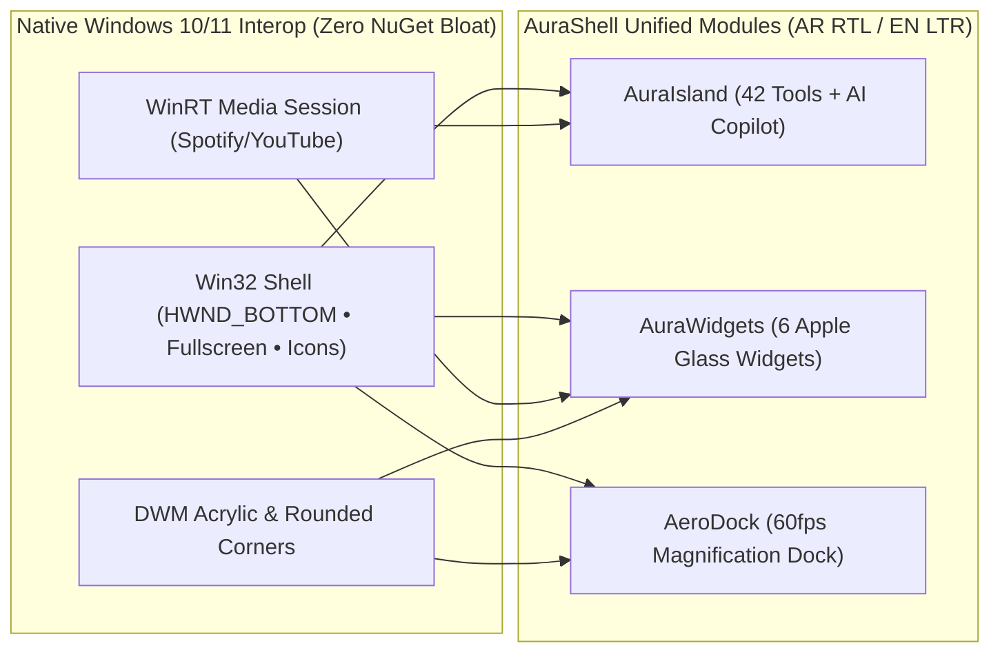

<div align="center">

<br />

# AuraShell

### Transform Windows 10 & 11 into a glass-native masterpiece.

**Dynamic Island (`40+` AI & System Tools) &nbsp;·&nbsp; Pixel-Accurate Apple Desktop Widgets &nbsp;·&nbsp; Floating Acrylic Dock**
<br />
<sub>Native C# (.NET 8 WPF) · Real Windows DWM Acrylic Blur · Full Arabic (RTL) &amp; English (LTR) Support</sub>

<br />

<p>
  <a href="https://github.com/a1n2a3s6/aurashell-win/releases"><strong>⬇ Download Windows .EXE</strong></a>
  &nbsp;&nbsp;·&nbsp;&nbsp;
  <a href="#the-three-pillars"><strong>✨ Explore Modules</strong></a>
  &nbsp;&nbsp;·&nbsp;&nbsp;
  <a href="#40-dynamic-island-capabilities"><strong>🏝️ 40+ Island Tools</strong></a>
  &nbsp;&nbsp;·&nbsp;&nbsp;
  <a href="#build-from-source"><strong>🛠️ Build</strong></a>
</p>

<br />

<a href="https://github.com/a1n2a3s6/aurashell-win/releases">
  
</a>

</div>

<br />

---

## The Three Pillars

Instead of installing three heavy, conflicting desktop customizers, **AuraShell** unifies everything inside one lightweight native **C# (.NET 8)** executable with shared telemetry, real **Windows DWM Acrylic Blur**, and instant **Arabic (RTL) / English (LTR)** localization.

| Pillar | What It Brings to Windows | Engineering Core |
| :--- | :--- | :--- |
| **01 · AuraIsland** | Spring-animated Dynamic Island at top-center packed with **40+ micro-tools**, live media visualizer, File Shelf & AI Copilot | WinRT SMTC · Spring Physics · Gemini / Groq Multimodal |
| **02 · AuraWidgets** | **6 pixel-accurate Apple macOS Sonoma / iOS 18 frosted-glass widgets** (Clock, Music, Health Rings, Weather, Calendar, Reminders) | `HWND_BOTTOM` Desktop Pin · DWM Acrylic · Open-Meteo |
| **03 · AeroDock** | Floating frosted-glass dock with **60fps parabolic cosine icon magnification**, running-app dots & drag-to-pin `.exe` support | Native OS Icon Extractor · Smart Fullscreen Auto-Hide |

---

## 40+ Dynamic Island Capabilities

<details open>
<summary><strong>🏝️ Expand all 5 AuraIsland Command Tabs (42 Built-In Micro-Features)</strong></summary>

| Island Tab | Built-In Capabilities |
| :--- | :--- |
| **🎵 Media & Audio (8)** | Live Spotify/YouTube/Chrome Album Art, Scrolling Track/Artist, Play/Pause, Next/Prev, 7-Bar Live Visualizer, Master Volume Slider, Mic Mute, Audio Output Quick-Open |
| **🤖 AI Copilot (8)** | Inline AI Chat, **Ask About My Screen** (live screenshot Q&A), **Instant Arabic ↔ English Translator**, Clipboard Summarizer, Spelling/Grammar Fixer, Code Explainer, 1-Click Copy Answer, Gemini/Groq Switcher |
| **📂 File Shelf & Clipboard (6)** | Drag-and-Drop Temporary **File Shelf** (hold & drag into any app), Shelf Badge, Clear Shelf, Last 5 Clipboard History Pills, Quick Pin Note, Mini Scratchpad |
| **⏱️ Productivity & Timers (8)** | 1-Click Pomodoro (`25m`), Custom Countdown, Stopwatch, Digital Clock + Date, Quick To-Do Counter, **Caffeine Keep-Awake**, Focus/DND Mode, Inline Quick Calculator |
| **⚡ Pro System Utilities (12)** | Live CPU %, RAM %, Battery % + Charging Pulse, Network Up/Down KB/s, **HEX Screen Color Eyedropper**, Quick Screenshot, Lock PC, Empty Recycle Bin, Copy Local IP, Clipboard QR Generator, Weather Pill, Studio Control Center |

</details>

---

## Authentic Apple Glass Widgets (`AuraWidgets`)

Designed strictly to **Apple Human Interface Guidelines** (`172×172` & `360×172` squircles, `CornerRadius=24`, real DWM Acrylic blur, `1px` specular glass edges, and `HWND_BOTTOM` desktop pinning so they stay behind your open apps):

- **Apple Calendar** — Bold red weekday header, light-weight day numeral, and daily schedule preview.
- **Apple Weather** — Live sky-gradient card powered by Open-Meteo (zero API key required).
- **Apple System Health Rings** — Four crisp activity rings tracking live **CPU, RAM, Battery, and SSD** usage.
- **Apple Music** — Real-time album artwork & transport controls synced directly to Windows SMTC.
- **Apple Hybrid Clock** — Smooth sweeping orange second hand with localized date pill.
- **Apple Reminders** — Interactive glass checklist persisted locally in JSON.

---

## 🌐 Native Bilingual Experience (العربية & English)

Switch seamlessly between **العربية (RTL)** and **English (LTR)** in one click from the AuraShell Studio header — every setting, widget header, and Dynamic Island label adapts its layout and reading direction automatically.

---

## Architecture



---

## Download & Build From Source

### Option 1 — Standalone Windows `.EXE`
Download **`aurashell-windows-x64.exe`** directly from **[GitHub Releases](https://github.com/a1n2a3s6/aurashell-win/releases)** and launch!

### Option 2 — Build From Source (.NET 8 SDK)
```powershell
git clone [https://github.com/a1n2a3s6/aurashell-win.git](https://github.com/a1n2a3s6/aurashell-win.git)
cd aurashell-win
dotnet run --project src/AuraShell/AuraShell.csproj
```

---

<div align="center">
  <br />
  <sub>
    <strong>AuraShell</strong> — Engineered by <a href="https://anas-alhelaly.vercel.app/"><strong>Anas Alhelaly</strong></a> · Day 19 of <em>365 Projects in 365 Days</em> · MIT License
    <br />
    <a href="https://anas-alhelaly.vercel.app/">Portfolio</a> &nbsp;·&nbsp;
    <a href="https://github.com/a1n2a3s6">GitHub</a> &nbsp;·&nbsp;
    <a href="https://www.instagram.com/anas.alhelaly/">Instagram</a>
  </sub>
  <br />
</div>
